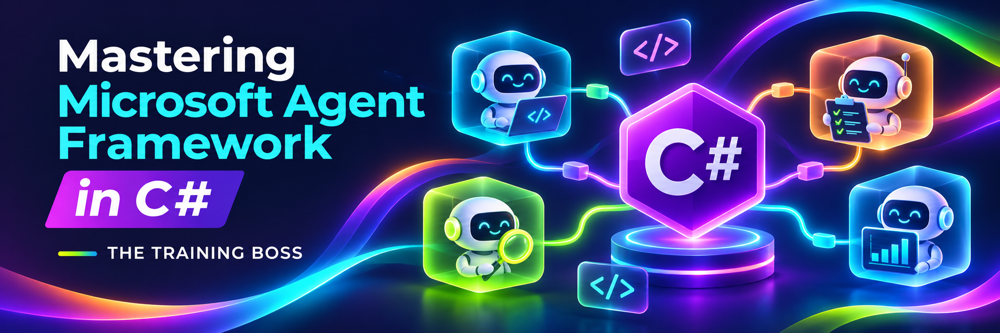

# Hands-On Workshop: Building AI Agents with Microsoft Agent Framework in C#

**Live! 360 Tech Con Orlando 2026 · Full-Day Post-Conference Hands-On Lab**

| | |
|---|---|
| **Date** | Friday, November 20, 2026 |
| **Time** | 8:00 AM – 5:00 PM (ET) |
| **Location** | Live! 360 Tech Con, Orlando, FL |
| **Instructor** | Lino Tadros, The Training Boss |
| **Session page** | [Live! 360 Orlando 2026 – Microsoft Agent Framework Hands-On Workshop](https://live360events.com/events/orlando-2026/sessions/friday/eaf01-hol-wrks-microsoft-agent.aspx) |

Welcome! This repository has the code for the workshop. During the day we'll go through about 22 hands-on labs, starting with a single call to a language model and ending with multi-agent workflows. Each lab starts with a short demo. Then you'll have time to run the code, change it, and try your own ideas.

> **Note:** This repository contains all 43+ examples from the full course, [**Mastering Microsoft Agent Framework in C#**](https://thetrainingboss.com/course/microsoft-agent-framework-fundamentals-csharp/). The workshop covers the labs listed in the [agenda](#workshop-agenda). The other projects are optional, so you can explore them on your own after the workshop.

---

## What You Will Learn

- How to connect agents to OpenAI, Azure OpenAI, Microsoft Foundry and local models (Ollama).
- Agent basics: instructions, streaming responses and multi-turn conversations.
- Giving agents tools: function calling, Code Interpreter, web search and the Model Context Protocol (MCP).
- Getting structured, strongly typed output from agents.
- Multimodal agents: image understanding, image generation and PDF input.
- Context and memory: AI context providers, chat history stored in Cosmos DB, and semantic caching.
- Connecting agents to user interfaces with the AG-UI protocol (server and client).
- Coordinating multiple agents with sequential and handoff workflows.

---

## Workshop Agenda

The times below are a guide. We'll adjust the pace to the room.

| Time | Module | Labs |
|---|---|---|
| 8:00 – 8:30 | Welcome, environment check & framework overview | — |
| 8:30 – 9:30 | **Module 1 – Connecting to Models** | 01, 02, 07, 08 |
| 9:30 – 10:15 | **Module 2 – Agent Fundamentals** | 10, 11 |
| 10:15 – 10:30 | ☕ Morning break | |
| 10:30 – 12:00 | **Module 3 – Tools & Structured Output** | 13, 14, 15, 16, 18 |
| 12:00 – 1:00 | 🍽️ Lunch | |
| 1:00 – 2:00 | **Module 4 – Multimodal Agents** | 24, 24b, 24c, 25 |
| 2:00 – 3:00 | **Module 5 – Context, Memory & Caching** | 26, 27, 28 |
| 3:00 – 3:15 | ☕ Afternoon break | |
| 3:15 – 4:00 | **Module 6 – Agents in the UI with AG-UI** | 29, 30 |
| 4:00 – 4:45 | **Module 7 – Multi-Agent Workflows** | 34, 36 |
| 4:45 – 5:00 | Wrap-up, Q&A and next steps | — |

### Module 1 – Connecting to Models

| Lab | Project | What you'll do |
|---|---|---|
| 01 | [01-OpenAIDemo](./src/01-OpenAIDemo) | Create your first agent using the OpenAI API. |
| 02 | [02-AzureOpenAIDemo](./src/02-AzureOpenAIDemo) | Run the same agent with an Azure OpenAI / Foundry model deployment. |
| 07 | [07-FoundryDemo](./src/07-FoundryDemo) | Create and run a server-side agent in a Microsoft Foundry project with Entra ID (Azure CLI) authentication. |
| 08 | [08-OllamaDemo](./src/08-OllamaDemo) | Run an agent with a local model served by Ollama. |

### Module 2 – Agent Fundamentals

| Lab | Project | What you'll do |
|---|---|---|
| 10 | [10-StreamingResponseDemo](./src/10-StreamingResponseDemo) | Stream tokens to the console as the model generates them. |
| 11 | [11-ChatConversationDemo](./src/11-ChatConversationDemo) | Keep a multi-turn conversation going with agent sessions. |

### Module 3 – Tools & Structured Output

| Lab | Project | What you'll do |
|---|---|---|
| 13 | [13-FunctionCallDemo](./src/13-FunctionCallDemo) | Expose C# methods as tools the agent can call. |
| 14 | [14-CodeInterpreterDemo](./src/14-CodeInterpreterDemo) | Use the hosted Code Interpreter tool to run code and generate charts. |
| 15 | [15-WebSearchDemo](./src/15-WebSearchDemo) | Answer questions with up-to-date information from the hosted web search tool. |
| 16 | [16-MCPDemo](./src/16-MCPDemo) | Connect an agent to a remote MCP server (Microsoft Learn MCP). |
| 18 | [18-StructuredOutputDemo](./src/18-StructuredOutputDemo) | Get strongly typed C# objects back from an agent. |

### Module 4 – Multimodal Agents

| Lab | Project | What you'll do |
|---|---|---|
| 24 | [24-ModelImageDemo](./src/24-ModelImageDemo) | Send images to an agent and ask questions about them. |
| 24b | [24b-ImageGenerationDemo](./src/24b-ImageGenerationDemo) | Generate images with OpenAI image models. |
| 24c | [24c-ImageGeneration-AzureOpenAI-Demo](./src/24c-ImageGeneration-AzureOpenAI-Demo) | Generate images with an Azure OpenAI image deployment. |
| 25 | [25-ModelPDFDemo](./src/25-ModelPDFDemo) | Send a PDF to an agent and have it analyze the document. |

### Module 5 – Context, Memory & Caching

| Lab | Project | What you'll do |
|---|---|---|
| 26 | [26-AIContextProviderDemo](./src/26-AIContextProviderDemo) | Add context to every agent run with a custom `AIContextProvider`. |
| 27 | [27-CosmosDBChatHistoryDemo](./src/27-CosmosDBChatHistoryDemo) | Save conversation history in Azure Cosmos DB. |
| 28 | [28-SemanticCacheDemo](./src/28-SemanticCacheDemo) | Use embeddings and a semantic cache to reduce cost and latency. |

### Module 6 – Agents in the UI with AG-UI

| Lab | Project | What you'll do |
|---|---|---|
| 29 | [29-AGUIServerDemo](./src/29-AGUIServerDemo) | Host an agent behind an AG-UI endpoint with ASP.NET Core. |
| 30 | [30-AGUIClientDemo](./src/30-AGUIClientDemo) | Connect a client to the AG-UI server and chat with the remote agent. |

### Module 7 – Multi-Agent Workflows

| Lab | Project | What you'll do |
|---|---|---|
| 34 | [34-SequentialWorkflowDemo](./src/34-SequentialWorkflowDemo) | Chain agents together in a sequential workflow. |
| 36 | [36-HandoffWorkflowDemo](./src/36-HandoffWorkflowDemo) | Have agents hand off a conversation to the right specialist. |

---

## Before the Workshop

**Please set up your laptop before you arrive.** The day is hands-on, and installing tools over conference Wi-Fi takes away from lab time.

### Required

- **Your own laptop** (Windows, macOS or Linux).
- **[.NET 10 SDK](https://dotnet.microsoft.com/download/dotnet/10.0)**. All projects target `net10.0`.
- **Visual Studio 2026** or **Visual Studio Code** with the [C# Dev Kit](https://marketplace.visualstudio.com/items?itemName=ms-dotnettools.csdevkit).
- **[Git](https://git-scm.com/downloads)**.
- **An Azure subscription** with access to [Microsoft Foundry](https://ai.azure.com) and the following model deployments:
  - `gpt-5`
  - `gpt-5-mini`
  - `text-embedding-3-small` (Lab 28)
  - `gpt-image-2` (Lab 24c)
- **[Azure CLI](https://learn.microsoft.com/cli/azure/install-azure-cli)**, signed in with `az login` (Lab 07).

### Recommended / Optional

- **An OpenAI API key** from [platform.openai.com](https://platform.openai.com/api-keys) (Labs 01, 14, 24, 24b, 25).
- **[Ollama](https://ollama.com/download)** with a local model pulled, for example `ollama pull gemma4` (Lab 08).
- **An Azure Cosmos DB for NoSQL account**, or the [Cosmos DB emulator](https://learn.microsoft.com/azure/cosmos-db/emulator) (Labs 27 and 28).

> If you can't get a resource, you can still follow the demo for that lab and come back to it later.

### Verify your setup

```bash
dotnet --version   # should report 10.x
git --version
az account show    # confirms you are signed in to Azure
```

---

## Getting Started

### 1. Clone the repository

```bash
git clone https://github.com/TheTrainingBoss/Orlando-Workshop-MAF.git
cd Orlando-Workshop-MAF
```

### 2. Open the solution

Open `TTB-AgentFramework-csharp.sln` in Visual Studio, or open the folder in VS Code. All projects are in the [src](./src) folder.

### 3. Configure your secrets

Most labs read their settings from **.NET User Secrets**, so your keys stay out of source control. The workshop projects use two shared User Secrets IDs, so you only need to set each value **twice** (once per ID):

| Key | Used for |
|---|---|
| `endpoint` | Your Azure OpenAI / Foundry resource endpoint, e.g. `https://<your-resource>.openai.azure.com` |
| `apikey` | Your Azure OpenAI / Foundry API key |
| `openaikey` | Your OpenAI API key (Labs 14, 24, 24b, 25) |
| `cosmosdbEndpoint` | Your Cosmos DB endpoint (Labs 27, 28) |
| `cosmosdbKey` | Your Cosmos DB key (Labs 27, 28) |

Run these commands from the repository root:

```bash
# Shared by labs 02, 10, 11, 13, 14, 15, 16, 18, 24b, 24c, 27, 34, 36
dotnet user-secrets set "endpoint" "<your-endpoint>" --id 1a482776-e7c1-4dfa-9179-40743b66d232
dotnet user-secrets set "apikey" "<your-api-key>" --id 1a482776-e7c1-4dfa-9179-40743b66d232
dotnet user-secrets set "openaikey" "<your-openai-key>" --id 1a482776-e7c1-4dfa-9179-40743b66d232
dotnet user-secrets set "cosmosdbEndpoint" "<your-cosmos-endpoint>" --id 1a482776-e7c1-4dfa-9179-40743b66d232
dotnet user-secrets set "cosmosdbKey" "<your-cosmos-key>" --id 1a482776-e7c1-4dfa-9179-40743b66d232

# Shared by labs 24, 25, 26, 28, 29
dotnet user-secrets set "endpoint" "<your-endpoint>" --id 8fc8b1d7-b2a5-4c0e-b621-c141e4037f31
dotnet user-secrets set "apikey" "<your-api-key>" --id 8fc8b1d7-b2a5-4c0e-b621-c141e4037f31
dotnet user-secrets set "openaikey" "<your-openai-key>" --id 8fc8b1d7-b2a5-4c0e-b621-c141e4037f31
dotnet user-secrets set "cosmosdbEndpoint" "<your-cosmos-endpoint>" --id 8fc8b1d7-b2a5-4c0e-b621-c141e4037f31
dotnet user-secrets set "cosmosdbKey" "<your-cosmos-key>" --id 8fc8b1d7-b2a5-4c0e-b621-c141e4037f31
```

A few labs need values entered directly in `Program.cs`:

- **Lab 01:** paste your OpenAI API key.
- **Lab 07:** paste your Microsoft Foundry **project** endpoint, and sign in with `az login`.
- **Lab 08:** make sure Ollama is running on `http://localhost:11434` with the model the code uses.

> ⚠️ **Never commit API keys.** If you paste a key into a source file during the workshop, remove it before you push any changes.

### 4. Run a lab

```bash
cd src/01-OpenAIDemo
dotnet run
```

Or set the project as the startup project in your IDE and press **F5**.

**AG-UI labs (29 and 30):** start the server first, then run the client in a second terminal:

```bash
# Terminal 1
cd src/29-AGUIServerDemo
dotnet run

# Terminal 2
cd src/30-AGUIClientDemo
dotnet run
```

The client connects to `http://localhost:5000`. If your server starts on a different port, update the client.

---

## Package Versions

All projects use **Central Package Management** ([Directory.Packages.props](./Directory.Packages.props)) and **Microsoft Agent Framework 1.28.0**. A few add-on packages (Foundry, Cosmos DB, AG-UI hosting) are available only as preview builds that match this version.

---

## Tips for the Day

- **Run first, then change.** Run each lab as it is, then change the prompts, instructions, tools or models and see what happens.
- **Fall behind? That's fine.** Each lab is self-contained, so you can skip ahead and still follow the next module.
- **Ask questions.** Interrupt anytime. That's what a hands-on workshop is for.
- **Watch your spending.** Cloud model calls cost money. The labs are small, but image generation and large models add up. Delete resources you don't need after the workshop.

These examples are for learning. Before you use them in production, review authentication (prefer managed identity / Entra ID over API keys), error handling, data protection, reliability and observability.

---

## After the Workshop

Want to keep going? The other projects in [src](./src) cover topics we didn't have time for, including:

- More model providers: Anthropic, Google Gemini, Grok, Mistral and Foundry Local (03–06, 09).
- Agents as tools (17) and Agent Skills (39).
- Embeddings, vector stores, semantic search and agentic RAG (19–22).
- Reasoning effort (23) and the Model Router (41).
- The DevUI (31) and OpenTelemetry observability (32).
- Workflows without AI, concurrent workflows, group chat and human-in-the-loop (33, 35, 37, 38).
- GitHub Copilot agents (40), plus image and video generation with Google models (42, 43).

For the full guided learning path with video lessons, see the course [**Mastering Microsoft Agent Framework in C#**](https://thetrainingboss.com/course/microsoft-agent-framework-fundamentals-csharp/).

## Questions and Feedback

Ask questions during the workshop, or open an [issue](https://github.com/TheTrainingBoss/Orlando-Workshop-MAF/issues) in this repository. Include the lab number, the steps to reproduce the problem and the error details. Remove credentials before you share logs or configuration.

## License

The source code is licensed under the [MIT License](LICENSE).
